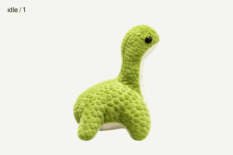

# 小水怪 · Xiaoshuiguai

一只 Apex Nessie 风格的绿色毛绒小水怪：浅块状肌理、奶油色肚皮，无尾巴、无拉链。

## 下载与内容

- `assets/spritesheet.png`：透明背景最终精灵图，1536 × 2288，PNG。
- `assets/frames/`：从最终精灵图提取的 73 张独立透明帧。
- `pet.json`：名称、网格、帧坐标、播放时长及视线方向信息。
- `previews/`：逐动作 GIF、全动作 GIF/MP4、视线循环、动作总览。
- `artwork/approved-reference.png`：最终确定的造型参考；洋红底用于制作，实际精灵图已去底。
- `validation/`：本版本的结构、质量与方向检查记录，已移除本机绝对路径。
- `SHA256SUMS.txt`：文件校验值。

## 精灵图布局

网格为 8 列 × 11 行，每格 192 × 208 像素。行、列均从 0 开始计数；每行从最左侧填充，未使用的格子透明。

| 行 | 状态 | 帧数 | 含义 |
| --- | --- | --- | --- |
| 0 | idle | 6 | 呼吸、眨眼待机 |
| 1 | running-right | 8 | 向右移动 |
| 2 | running-left | 8 | 向左移动 |
| 3 | waving | 4 | 挥鳍招呼 |
| 4 | jumping | 5 | 跳跃与落地 |
| 5 | failed | 8 | 低头受挫 |
| 6 | waiting | 6 | 等待输入 |
| 7 | running | 6 | 专注工作、思考 |
| 8 | review | 6 | 检查结果 |
| 9 | look | 8 | 000° 至 157.5° |
| 10 | look | 8 | 180° 至 337.5° |

视线按屏幕坐标顺时针排列，每步 22.5°：0° 向上、90° 向右、180° 向下、270° 向左。
`running` 表示工作状态；位移动作使用 `running-right` / `running-left`。

## 使用素材

可直接使用独立 PNG 帧，也可按 `pet.json` 的坐标裁取精灵图。帧时长以毫秒记录；保留每帧的 192 × 208 画布以维持动作定位。
`pet.json` 是本仓库的素材说明格式，不是官方插件或一键导入清单。此仓库提供图像资源与元数据，不包含桌面宠物运行程序。

## 上传到 GitHub

解压项目包，将此目录内的文件与文件夹放到你的仓库根目录后提交。保留 `README.md`、`assets` 和 `previews` 的相对位置，README 中的预览即可正确引用。
建议仓库名：`xiaoshuiguai-pet`。项目包未包含账号宠物 ID、临时下载链接、聊天记录或原始手机参考照片。

## 制作与检查

造型依据用户最终确定的参考图，使用 AI 生成动作素材并确定性抽帧、拼合及去底。最终图集共 73 帧、15 个透明空格。
结构检查、动画质量检查及三份独立方向盲审均通过。质量记录中的透明区域提示对应鳍肢之间的自然留白；详细信息见 `validation/`。

## 素材来源说明

本项目是受 Apex Legends Nessie 启发的非官方同人形象，未获官方背书。项目未附加开源许可证或声明拥有相关角色、商标的权利；公开发布与再利用范围由权利人和发布者自行确认。
